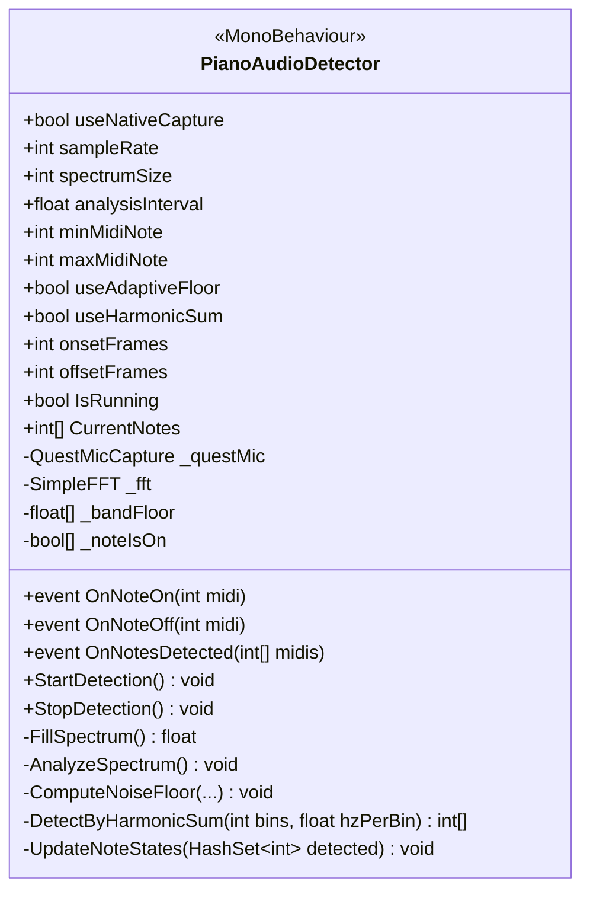
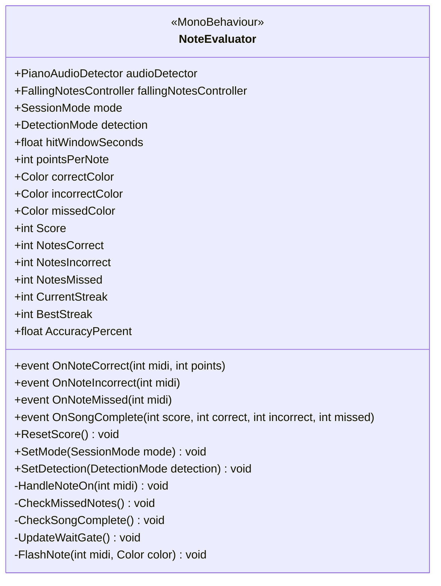
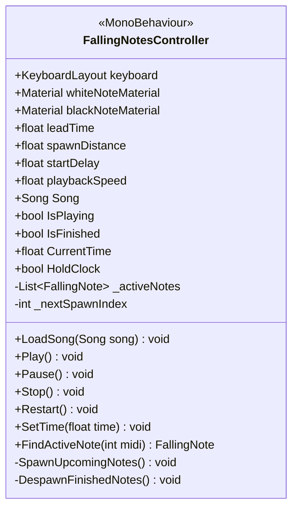
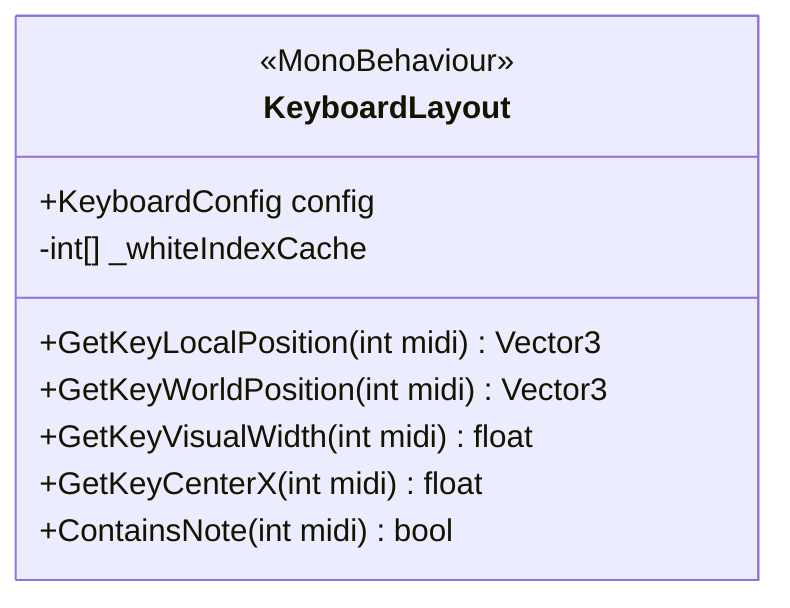
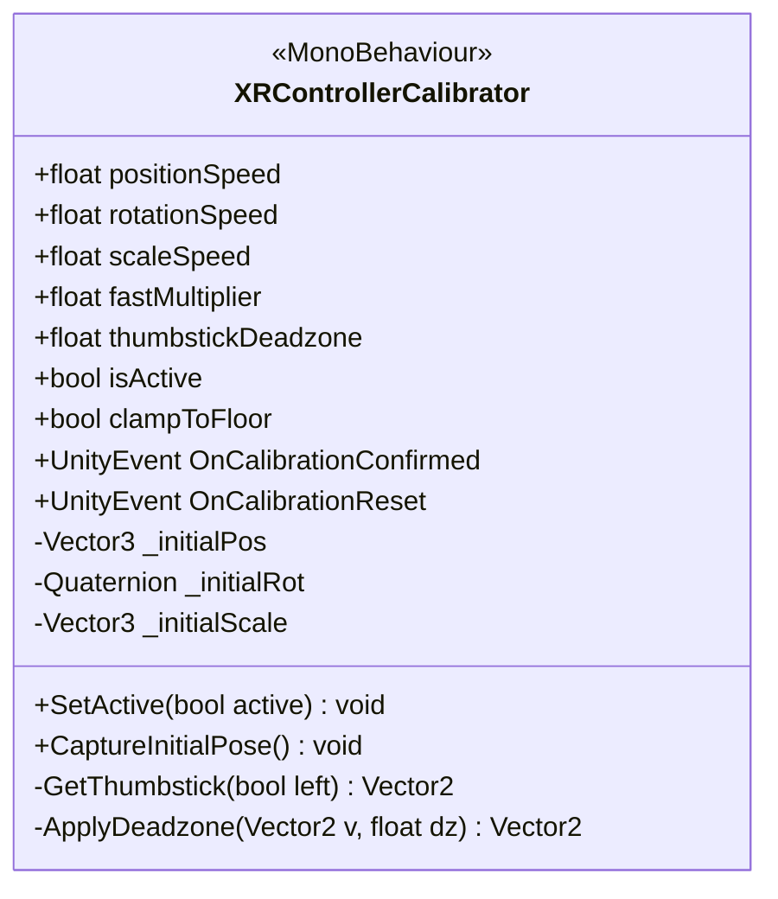

# Piano Learning AR — Five Key Classes

These are the five classes that carry the system's core requirements: detect what the player
plays, show what they should play, line it up with the real piano, and judge the result. Each
class is shown on its own as a UML class box (key members only; `+` public, `-` private), followed
by a short description of what it is responsible for.

---

## 1. PianoAudioDetector

`PianoAudioDetector` is the project's core research contribution: it turns live microphone audio
into piano notes without any MIDI hardware. It captures audio from the Quest's microphone (through
the native unprocessed capture path where available), applies a Blackman-Harris window and an FFT
following Putranda et al. (2023), and then identifies which keys are sounding using an adaptive
noise floor and harmonic-sum scoring, so a note's overtones are not mistaken for extra notes. A
per-note state machine debounces the result, so each keystroke raises exactly one `OnNoteOn` event
and one `OnNoteOff` event, which the rest of the app listens to.

---

## 2. NoteEvaluator

`NoteEvaluator` is the link between what the player plays and what the song expects. Every time a
note is detected, it checks whether that note is due within the hit window and marks it correct,
incorrect or missed, flashing the falling note green, red or grey as visual feedback. It keeps the
assessment statistics the proposal asks for (score, accuracy, timing and note streak) and
announces when a song is complete so the results board can be shown. It also controls the two
session modes: in Practice it holds the song until the correct note is played, and in Assessment
the song runs in real time and is scored.

---

## 3. FallingNotesController

`FallingNotesController` drives the falling-note interface that the player sees over the real
piano. It loads a `Song`, owns the playback clock, and spawns each note as a block above its key
shortly before the note is due, so that the block reaches the keyboard exactly when it should be
played, then removes it once it has passed. It provides the playback controls the user interacts
with (play, pause, restart and tempo through `playbackSpeed`), and it exposes `HoldClock` so the
evaluator can pause the song in Practice mode while waiting for the right note.

---

## 4. KeyboardLayout

`KeyboardLayout` is the virtual model of the physical piano keyboard. Using the key range and key
sizes stored in its `KeyboardConfig`, it converts any MIDI note number into the position and width
of that key in 3D space, accounting for the different layouts of white and black keys. Every other
visual part of the app asks this class where a key is, so the falling notes line up with the real
keys. Because all positions are relative to this object, aligning the whole virtual keyboard with
the real piano only requires moving this one object.

---

## 5. XRControllerCalibrator

`XRControllerCalibrator` implements the manual keyboard calibration from the proposal. It lets the
user line the virtual keyboard up with their physical piano using the Quest Touch controllers: the
thumbsticks move the keyboard and rotate it, the X and Y buttons scale its width to match the
real keys, the trigger speeds movement up for coarse placement, B resets it, and A confirms the
calibration. It acts directly on the `KeyboardLayout` object, so once calibration is confirmed
every falling note is positioned over the correct physical key.

---

## How they fit together

`XRControllerCalibrator` positions `KeyboardLayout` over the real piano. `FallingNotesController`
uses `KeyboardLayout` to drop each note of the song onto the right key. `PianoAudioDetector` listens
to the player, and `NoteEvaluator` compares its detected notes with the notes
`FallingNotesController` currently expects, then colours the notes and keeps the score.
